# 02 — Diagrams: Microplastic Detection System
### Indisposable | Gagangiri Foods Industry Project | Feb–May 2026

---

## Table of Contents

1. [High-Level Design (HLD)](#1-high-level-design-hld)
2. [Low-Level Design (LLD)](#2-low-level-design-lld)
3. [System Architecture Diagram](#3-system-architecture-diagram)
4. [End-to-End Data Flow Diagram](#4-end-to-end-data-flow-diagram)
5. [ML Pipeline Flowchart](#5-ml-pipeline-flowchart)
6. [MobileNetV2 + Custom Head Architecture](#6-mobilenetv2--custom-head-architecture)
7. [Transfer Learning Process Diagram](#7-transfer-learning-process-diagram)
8. [Preprocessing Pipeline Diagram](#8-preprocessing-pipeline-diagram)
9. [Training Loop Diagram](#9-training-loop-diagram)
10. [Evaluation Metrics Diagram](#10-evaluation-metrics-diagram)
11. [Flask API Sequence Diagram](#11-flask-api-sequence-diagram)
12. [DHM Integration Diagram](#12-dhm-integration-diagram)
13. [Class Hierarchy / Module Diagram](#13-class-hierarchy--module-diagram)
14. [Dataset Split Diagram](#14-dataset-split-diagram)
15. [Confusion Matrix Explanation Diagram](#15-confusion-matrix-explanation-diagram)

---

## 1. High-Level Design (HLD)

The HLD shows the big-picture components of the system and how they interact at a conceptual level, without implementation detail.

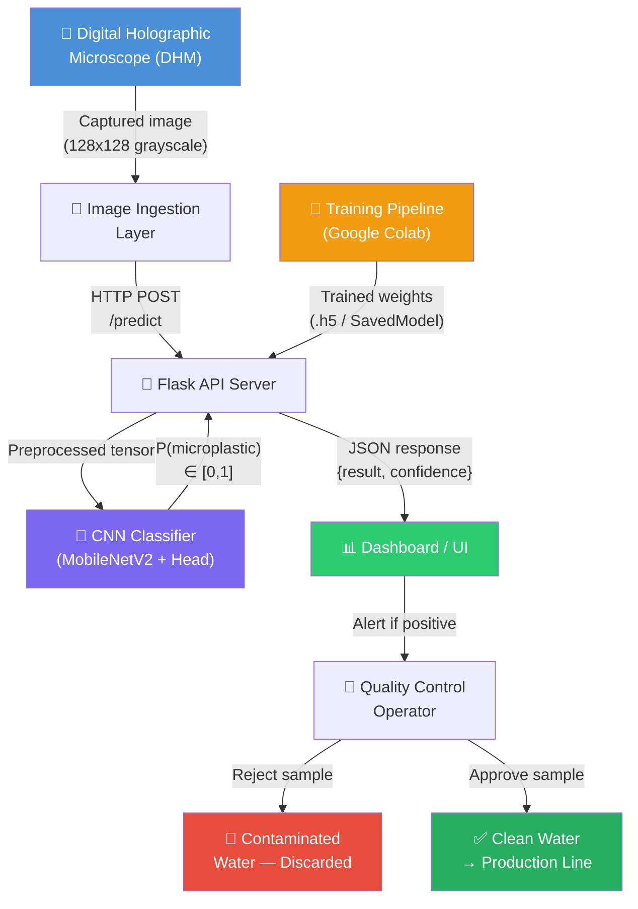

### HLD Explanation

The system has four major zones:

**Zone 1 — Acquisition:** The DHM captures microscopic images of water samples from Gagangiri Foods' water supply. Images are in grayscale, standardized to 128×128 pixels.

**Zone 2 — Inference:** The Flask API server receives images, applies the preprocessing pipeline, and runs inference using the trained CNN model. It returns a JSON response with the classification result and confidence score.

**Zone 3 — Decision:** The dashboard visualizes results in real time. Quality control operators are alerted when contamination is detected. They make the final call on whether to discard the water or allow it into the production line.

**Zone 4 — Training (Offline):** The model training pipeline runs on Google Colab using the labeled Kaggle dataset. The trained model is exported and loaded by the Flask API. This is a one-time (or periodic retraining) process.

---

## 2. Low-Level Design (LLD)

The LLD details the internal components, classes, functions, and data structures within each module.

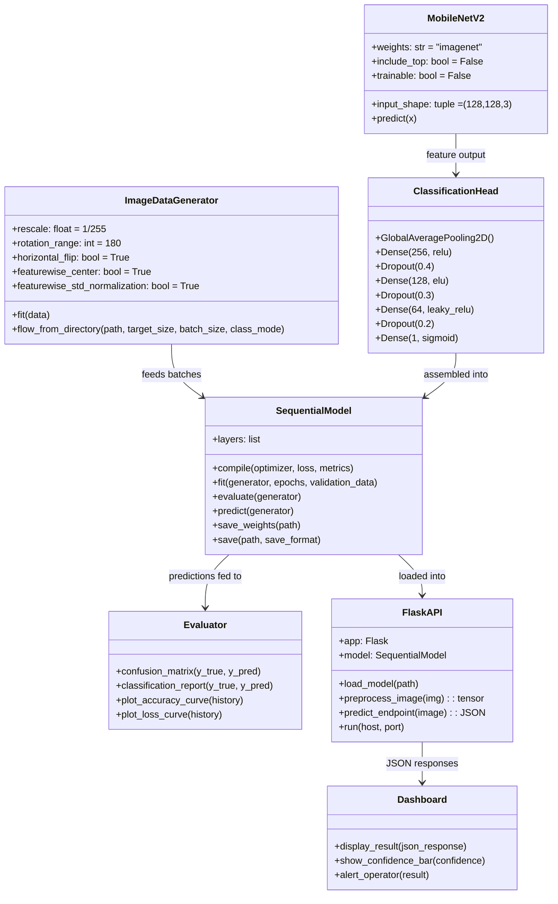

### LLD Explanation

**ImageDataGenerator:** Keras utility that handles loading, augmenting, and batching images from disk. Configured with augmentation parameters (rotation, flip, shift) and normalization (rescale, featurewise center/std).

**MobileNetV2:** Pretrained base model. Its `trainable = False` flag is the core of the feature extraction strategy. Outputs a 4D feature tensor.

**ClassificationHead:** The custom 4-layer dense network we trained. Takes the pooled features from MobileNetV2 and produces a binary probability.

**SequentialModel:** Keras Sequential container that chains MobileNetV2 → ClassificationHead. Handles compile, training, evaluation, and serialization.

**Evaluator:** Standalone evaluation functions from sklearn and matplotlib. Produces confusion matrix, classification report, and training curves.

**FlaskAPI:** Serves the model over HTTP. Receives raw image bytes, applies the same preprocessing used during training, and returns predictions.

**Dashboard:** Frontend that consumes the Flask API. Displays results, confidence levels, and triggers alerts.

---

## 3. System Architecture Diagram

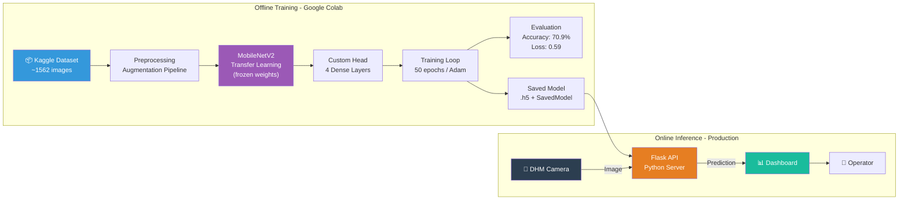

### Architecture Explanation

The system is split into **offline** and **online** phases:

**Offline (Training):** Done once on Google Colab using the labeled Kaggle dataset. The model trains for 50 epochs and is saved to Google Drive in two formats. This phase is compute-intensive and is not repeated unless retraining is needed.

**Online (Production):** The Flask API loads the saved model and serves predictions in real time. The DHM sends images, the API processes them, and the dashboard displays results to the operator. This phase is lightweight and fast (inference on a single image takes milliseconds).

This separation of concerns is a key architectural decision — the production system is fast and stateless; it does not need to know anything about training.

---

## 4. End-to-End Data Flow Diagram

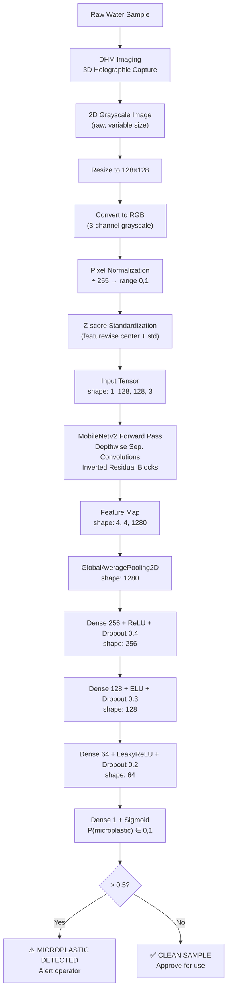

### Data Flow Explanation

This diagram traces a single water sample image through the complete pipeline:

1. **Physical capture (DHM):** The DHM records the hologram and reconstructs a 2D intensity image
2. **Standardization:** All preprocessing steps transform the raw image into a consistent tensor the model expects
3. **Feature extraction (MobileNetV2):** 1280 abstract feature values are computed from the 4×4 spatial grid
4. **Pooling:** Spatial information is aggregated, making the representation position-independent
5. **Classification (Dense layers):** The 1280 features are progressively transformed to a single probability
6. **Decision:** Threshold at 0.5 converts probability to a binary class label

---

## 5. ML Pipeline Flowchart

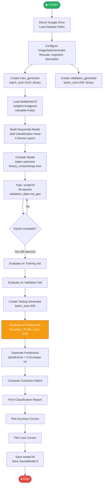

### Pipeline Explanation

The ML pipeline follows a strict sequential order:

**Setup phase:** Mount Drive, configure data generators. The generators encapsulate all preprocessing so it's applied consistently to train, validation, and test data.

**Model building phase:** Load MobileNetV2 as a frozen feature extractor, add the custom head. Compile with loss function and optimizer.

**Training phase:** Run 50 epochs with the training generator. Validation data is evaluated after each epoch automatically.

**Evaluation phase:** Three evaluations — training, validation, and testing — provide a complete picture of model performance. The test set evaluation is the final, unbiased result.

**Reporting phase:** Confusion matrix and classification report give detailed per-class metrics. Plots visualize the learning dynamics over epochs.

**Deployment phase:** Model is saved in two formats for use by the Flask API.

---

## 6. MobileNetV2 + Custom Head Architecture

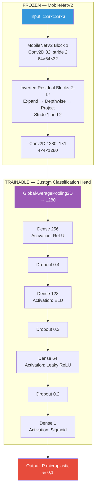

### Architecture Explanation

The model has two clearly separated zones:

**Frozen zone (MobileNetV2):** 17 inverted residual blocks that progressively extract features. The spatial resolution decreases (128→64→32→16→8→4) while the channel depth increases (32→16→24→32→64→96→160→320→1280). These weights are fixed at their ImageNet-pretrained values.

**Trainable zone (Custom Head):** The classification head starts with GlobalAveragePooling (which collapses the 4×4×1280 spatial feature maps into a 1280-dimensional vector) and then passes through 4 dense layers with progressively fewer neurons, each followed by dropout. The final sigmoid outputs the microplastic probability.

The separation ensures that 3.4M pretrained parameters are preserved and only ~369K new parameters are trained on our small dataset.

---

## 7. Transfer Learning Process Diagram

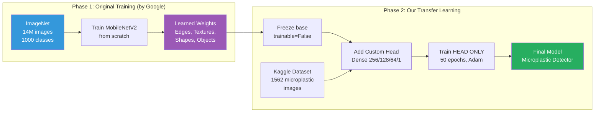

### Transfer Learning Explanation

**Why this works:** The early layers of MobileNetV2 (trained on 14M ImageNet images) detect universal visual primitives — edges, gradients, curves, blobs. These primitives are present in microscopy images just as they are in natural photographs. The frozen base provides these universal detectors for free.

Our custom head learns the decision logic: "given these 1280 visual features, what combination indicates a microplastic particle?" This requires much less data to learn than the feature extractor itself.

**Analogy:** MobileNetV2 is like a PhD-educated expert in "seeing" — we just teach this expert one new specific skill (microplastic detection) using 1,562 labeled examples, rather than rebuilding the expert from scratch.

---

## 8. Preprocessing Pipeline Diagram

```mermaid
flowchart LR
    A["Raw Image\ne.g. 512×512 RGB"] -->|"squeeze + resize"| B["128×128 RGB"]
    B -->|"rgb2gray"| C["128×128 Grayscale\n1 channel"]
    C -->|"ImageDataGenerator\nreplicates to 3ch"| D["128×128×3\n(3 identical channels)"]
    D -->|"rescale ÷255"| E["Pixels in 0,1"]
    E -->|"featurewise_center"| F["Subtract dataset mean\nμ = 0"]
    F -->|"featurewise_std_norm"| G["Divide by dataset std\nσ = 1"]
    G -->|"Augmentation\nrotation/flip/shift"| H["Augmented Tensor\n128×128×3\nReady for model"]

    style A fill:#E74C3C,color:#fff
    style H fill:#27AE60,color:#fff
```

### Preprocessing Explanation

Every transformation in the preprocessing pipeline serves a purpose:

**Resize (128×128):** Standardizes all images to the same spatial dimensions — required for batched processing. Reduces computation vs higher resolutions.

**Grayscale:** Removes irrelevant color information (microplastics in water look gray-white under any lighting). Saves memory.

**3-channel replication:** MobileNetV2 expects 3-channel input because it was trained on RGB ImageNet images. Grayscale values are replicated across R, G, B channels.

**Rescale ÷255:** Maps [0,255] → [0,1]. Neural networks with sigmoid/ReLU activations work best with small, bounded inputs.

**Z-score normalization:** Centers data at zero mean and unit variance, matching the preprocessing done during ImageNet training of MobileNetV2.

**Augmentation:** Artificially expands the training set by creating modified copies of existing images. Applied only during training, not inference.

---

## 9. Training Loop Diagram

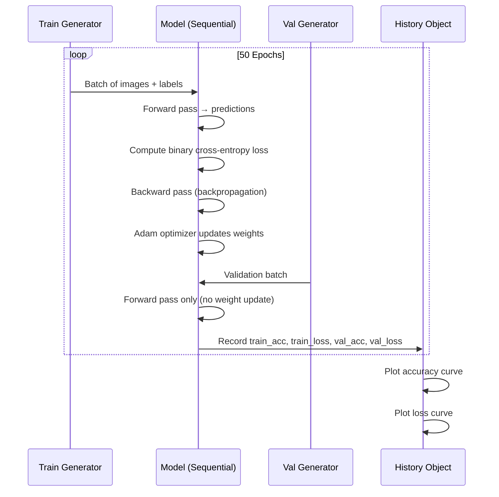

### Training Loop Explanation

**Per-epoch process:**
1. **Training step:** The generator feeds one batch. Forward pass computes predictions, loss measures error, backward pass computes gradients, Adam updates weights. This constitutes one training step.
2. **Validation step:** After each epoch, the validation generator feeds its data. The model processes it in inference mode (no weight updates, dropout disabled). This measures generalization.
3. **History recording:** Four metrics are recorded per epoch: training accuracy, training loss, validation accuracy, validation loss.

**What we look for in the curves:**
- Both train and val accuracy rising together → healthy learning
- Val accuracy plateauing while train continues rising → overfitting beginning
- Val loss increasing while train loss decreases → clear overfitting signal

---

## 10. Evaluation Metrics Diagram

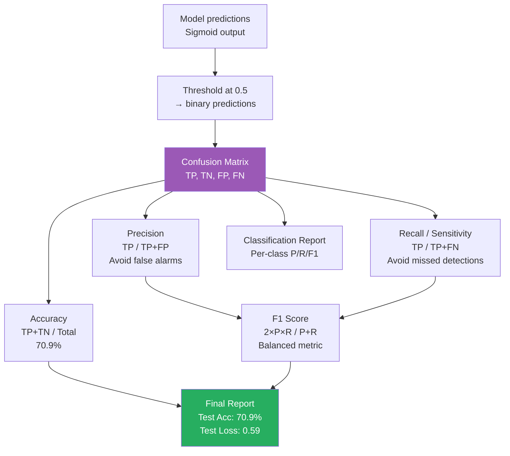

### Metrics Explanation

**From sigmoid output to metrics:**
The model produces a continuous probability score. The threshold (0.5) converts this to a binary prediction. The confusion matrix is built by comparing these binary predictions to the true labels.

**Metric hierarchy:**
- Confusion matrix is the **primary source** — all metrics derive from it
- Accuracy gives a single-number overview
- Precision and Recall break down performance by type of error
- F1 balances both
- Classification Report gives per-class breakdown

**For food safety:** Recall for the positive class (microplastic) is the most critical metric — we must maximize the detection rate of actual contamination.

---

## 11. Flask API Sequence Diagram

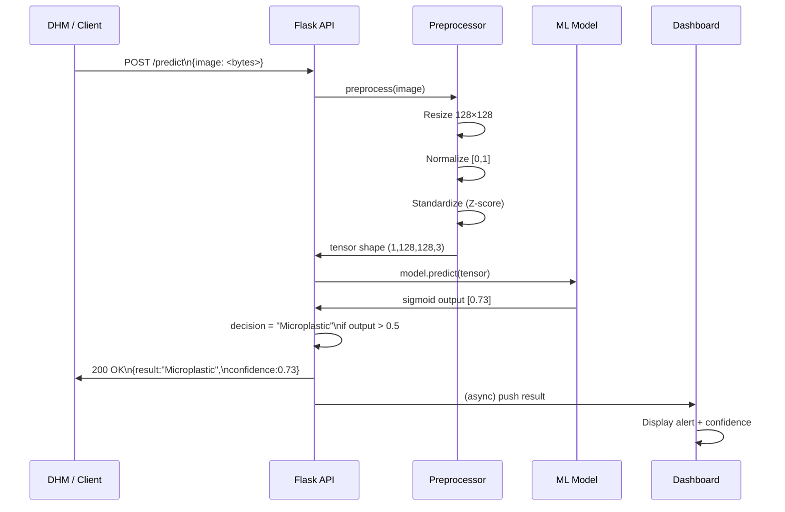

### Flask API Explanation

**Request flow:**
1. The DHM system (or test client) sends a POST request with the raw image bytes
2. Flask receives the request and passes the image to the preprocessing module
3. Preprocessing applies the identical transformations used during training (critical: inference preprocessing must match training preprocessing)
4. The model runs inference and returns the raw sigmoid output
5. Flask applies the 0.5 threshold, formats a JSON response with the result and confidence, and returns it
6. The dashboard receives the response and updates the display

**Key design principle:** The preprocessing in the API must be identical to the preprocessing during training. Any mismatch (different normalization, different resize algorithm) will degrade prediction quality significantly.

---

## 12. DHM Integration Diagram

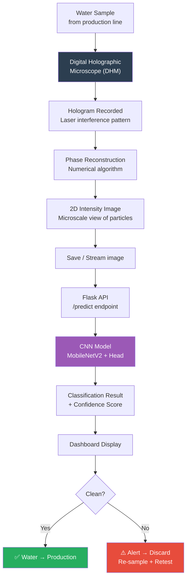

### DHM Integration Explanation

**Physical pipeline:**
Water is sampled from the production line inlet. The sample is placed under the DHM, which uses laser-based holography to image the sample. The phase reconstruction algorithm converts the hologram into a viewable intensity image showing the spatial distribution of particles.

**Digital pipeline:**
The reconstructed image is saved or streamed to the Flask API. The API processes and classifies it. The result is displayed within seconds, enabling near-real-time quality control decisions.

**Operational impact for Gagangiri Foods:**
Traditional lab testing might take hours or require shipping samples to external labs. This integrated system provides results in near-real-time, allowing contaminated water to be intercepted before it enters any food product.

---

## 13. Class Hierarchy / Module Diagram

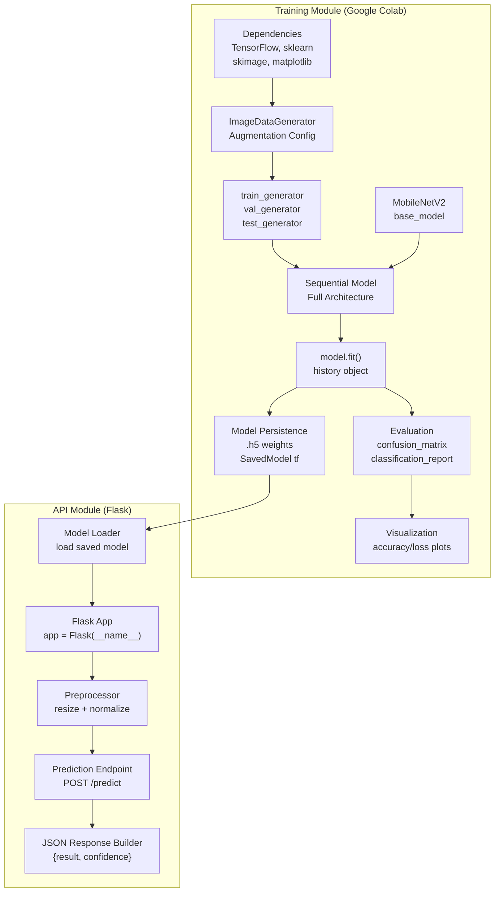

### Module Explanation

**Training module is self-contained:** All code runs in Google Colab with Google Drive for storage. Dependencies, data loading, model building, training, evaluation, and saving are all sequential steps in one notebook.

**API module is independent:** The Flask API only needs the saved model file and the preprocessing logic. It does not depend on or import anything from the training notebook. This clean separation means the production system can be updated (new model version) without changing the API code.

---

## 14. Dataset Split Diagram

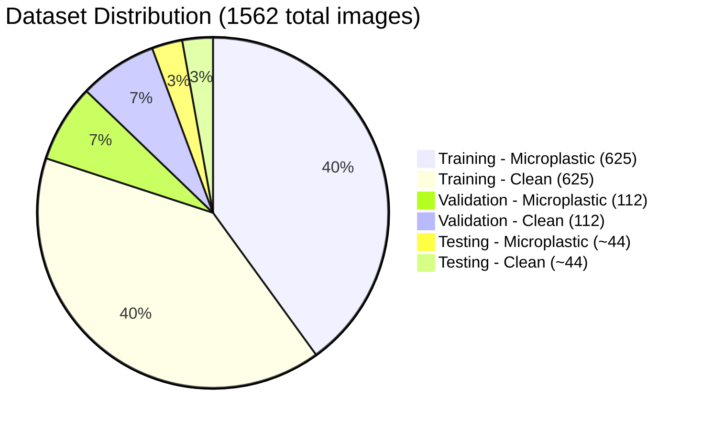

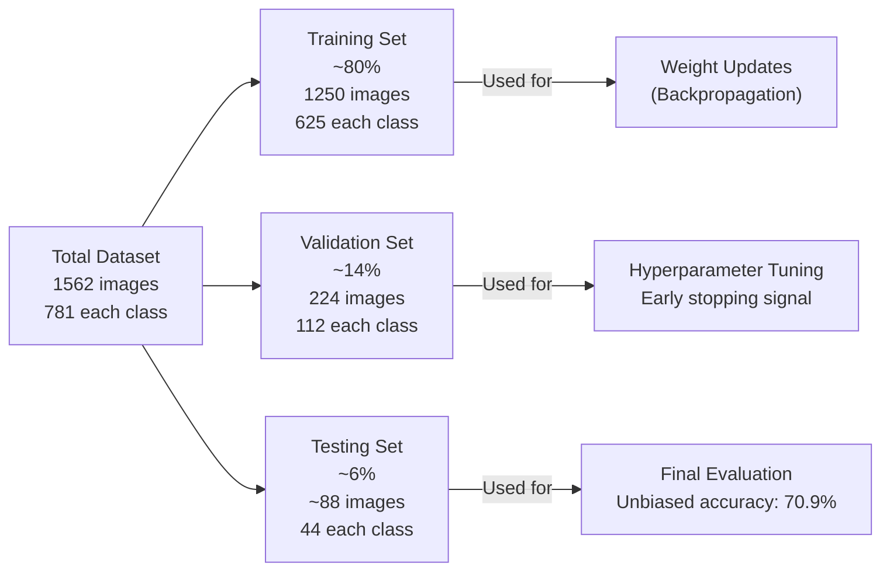

### Dataset Split Explanation

**Three-way split rationale:**

**Training set (80%):** The data the model learns from. Weights are updated based on training set loss. The model sees each image 50 times (50 epochs) with augmentation variations.

**Validation set (14%):** Used during training but NOT for weight updates. After each epoch, the model evaluates validation accuracy and loss. This reveals overfitting early. If val accuracy drops while train accuracy rises, we stop or regularize.

**Testing set (6%):** The model never sees this data during training or hyperparameter selection. The 70.9% accuracy reported comes from this set and represents true generalization ability.

**Why not just train/test?** If we used the same set for both hyperparameter tuning and final evaluation, the evaluation would be optimistically biased — we'd have implicitly chosen hyperparameters that work well on the test set.

---

## 15. Confusion Matrix Explanation Diagram

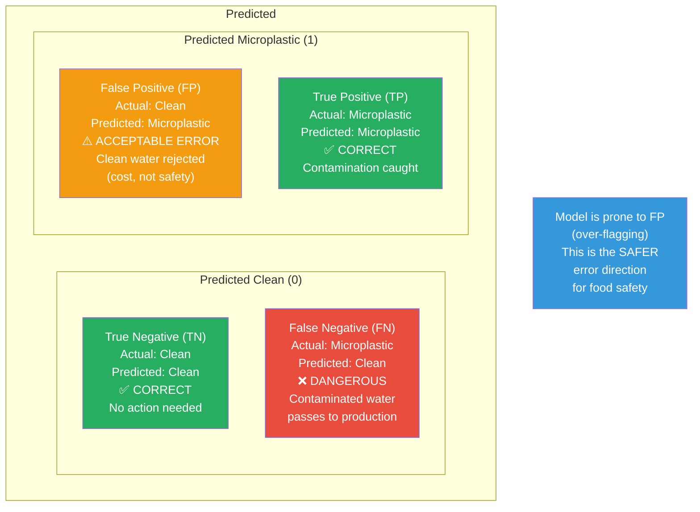

### Confusion Matrix Explanation

The README explicitly states the model is "prone to false positives." This diagram explains why that is the **safer and more acceptable failure mode** for this application.

**False Negative (bottom-left) = DANGER:** The model says the water is clean, but it actually contains microplastics. This contaminated water would enter the food production pipeline, potentially reaching consumers. This is the error type we most want to avoid.

**False Positive (top-right) = COST:** The model says the water is contaminated, but it's actually clean. Clean water is flagged, the operator investigates, finds nothing wrong, and the water is eventually approved or the batch is discarded unnecessarily. This wastes time and water, but nobody is harmed.

**Design implication:** The model's false positive tendency means its **recall is high** (it rarely misses actual microplastics). From a food safety engineering standpoint, this is the correct trade-off. The model errs on the side of caution, which aligns perfectly with the client's (Gagangiri Foods') need to protect product quality and consumer safety.

---

*This document contains all key architectural, flow, and design diagrams for the Indisposable microplastic detection system. Each diagram is paired with a detailed explanation of the design decisions and what the diagram communicates about the system.*
